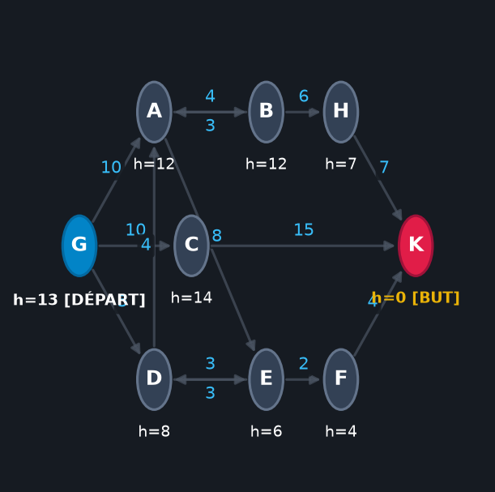
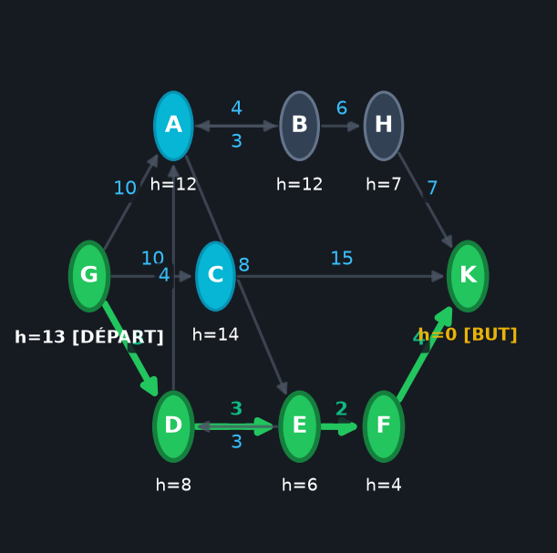
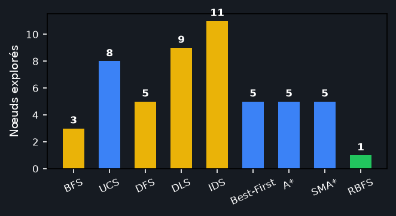
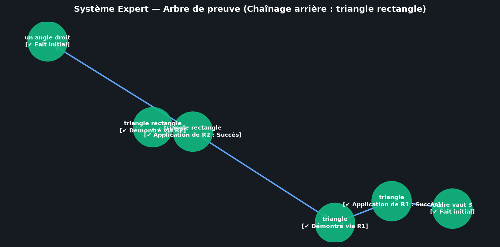

# Système Expert & Algorithmes de Recherche dans les Espaces d'États

**École Nationale des Sciences de l'Informatique (ENSI)**  
**Filière :** II2 — Module « Intelligence Artificielle et Machine Learning »  
**Projet Académique :** Devoir 1 — Moteur d'Inférence d'Ordre 0+ & Recherche dans les Graphes d'États

---

## 1. Vue d'Ensemble du Projet

Ce projet propose une application desktop moderne, robuste et pédagogique développée en Python avec **CustomTkinter**, **Matplotlib** et **NetworkX**. L'application implémente fidèlement les fondements de l'IA symbolique et classique abordés en cours à l'ENSI :

1. **Module 1 — Systèmes Experts (Moteur d'inférence d'ordre 0+) :**
   - Représentation formelle de la base de faits et de la base de règles conditionnelles.
   - **Chaînage avant déterministe** : ordonnancement strict des règles, exécution avec but spécifique ou saturation complète, détection automatique des buts initiaux, journal horodaté et traçabilité détaillée étape par étape.
   - **Chaînage arrière récursif** : décomposition arborescente en sous-buts, retour sur trace (*backtracking*), protection contre les boucles cycliques et arbre de preuve hiérarchique avec validations visuelles `[✔]` ou `[✘]`.
   - **Chaînage mixte (Bonus)** : sélection des règles pertinentes par filtrage arrière et saturation avant dirigée.
   - Éditeur interactif complet : ajout, modification, suppression de faits et de règles, ainsi qu'import/export de bases au format JSON.

2. **Module 2 — Algorithmes de Recherche dans les Espaces d'États :**
   - Modélisation de graphes orientés et pondérés avec coûts strictement positifs et heuristiques $h(n)$.
   - Algorithmes non informés (aveugles) : **BFS**, **UCS** (Dijkstra), **DFS**, **DLS** (profondeur limitée) et **IDS** (approfondissement itératif).
   - Algorithmes informés (heuristiques) : **Recherche Gloutonne (Best-First)**, **A\*** (avec réouverture des fermés), **SMA\*** (A* à mémoire bornée avec élagage du pire $f$) et **RBFS** (Recursive Best-First Search en espace linéaire).
   - **Vérificateur formel d'heuristique** : calcul automatique de l'admissibilité ($h(n) \le h^*(n)$) et de la consistance / monotonie ($h(n) \le c(n, n') + h(n')$).
   - **Onglet Comparaison & Benchmark (Bonus)** : exécution comparative de tous les algorithmes sur le graphe courant avec tableau synthétique (temps en ms, coût, nœuds développés, optimalité) et diagramme à barres dynamique.

La logique algorithmique (`core/`) est **strictement découplée** de l'interface graphique (`gui/`) et ne dépend d'aucun module d'IHM, facilitant les tests unitaires et la réutilisation.

---

## 2. Architecture du Projet

```
Projet1_IA/
├── main.py                     # Point d'entrée de l'application
├── run.sh                      # Script de démarrage 1-clic pour Linux et macOS
├── run.bat                     # Script de démarrage 1-clic pour Windows
├── requirements.txt            # Dépendances Python minimales et certifiées
├── README.md                   # Documentation complète et guide technique
├── DEMO.md                     # Scénario minuté (2-3 min) pour présentation en soutenance
├── .gitignore                  # Exclusion des caches, environnements et fichiers temporaires
│
├── core/                       # Logique métier pure (indépendante de la GUI)
│   ├── __init__.py             # Exports du package métier
│   ├── expert_system.py        # Moteur d'inférence (Rule, KnowledgeBase, Forward/Backward, Traces)
│   └── search_algorithms.py    # Graphe, BFS, UCS, DFS, DLS, IDS, Best-First, A*, SMA*, RBFS, Benchmark
│
├── gui/                        # Interface graphique CustomTkinter moderne
│   ├── __init__.py
│   ├── app.py                  # Fenêtre principale, en-tête académique, thème Clair/Sombre, navigation
│   ├── expert_view.py          # Vue complète du Module 1 (Systèmes Experts)
│   ├── search_view.py          # Vue complète du Module 2 (Graphe interactif, Algorithmes, Comparatif)
│   └── widgets.py              # Composants réutilisables (CardFrame, MessageDialog, Badges)
│
├── data/                       # Données de référence et cas d'étude académiques (JSON)
│   ├── graphe_cours.json       # Graphe orienté pondéré du cours ENSI avec heuristiques
│   ├── kb_tarte.json           # Base pâtisserie (Tarte aux fruits, aux pommes, aux abricots)
│   ├── kb_triangle.json        # Base géométrique (Triangles, rectangles, isocèles)
│   ├── kb_autruche.json        # Base zoologique (Classification de l'autruche)
│   └── kb_exercice.json        # Base théorique d'examen (C déduit de E, F)
│
├── docs/                       # Documentation et captures d'écran
│   └── screenshots/
│       ├── SCREENSHOTS.md      # Galerie et description détaillée des vues
│       ├── capture_screenshots.py # Script de régénération automatique des visuels
│       ├── graphe_visualisation.png
│       ├── recherche_astar_solution.png
│       ├── comparaison_algorithmes.png
│       └── expert_arbre_preuve.png
│
└── tests/                      # Suite de tests unitaires automatisés (80 tests, 100% succès)
    ├── __init__.py
    ├── test_expert_system.py   # Tests du moteur d'inférence (cas nominaux, limites, cycles)
    └── test_search.py          # Tests des algorithmes de recherche et benchmark comparatif
```

---

## 3. Prérequis et Installation

### Prérequis Système
- **Python 3.10 ou supérieur** (développé et testé sous Python 3.12).
- Bibliothèque graphique système **Tkinter** :
  - **Ubuntu / Debian :** `sudo apt install python3-tk`
  - **Fedora / RHEL :** `sudo dnf install python3-tkinter`
  - **Arch Linux :** `sudo pacman -S tk`
  - **Windows / macOS :** Inclus automatiquement avec l'installateur officiel Python.org.

### Installation Pas-à-Pas

```bash
# 1. Cloner ou se placer dans le répertoire du projet
cd Projet1_IA

# 2. Créer l'environnement virtuel
python3 -m venv .venv

# 3. Activer l'environnement virtuel
source .venv/bin/activate       # Sous Linux / macOS
# ou .venv\Scripts\activate    # Sous Windows

# 4. Installer les dépendances
pip install --upgrade pip
pip install -r requirements.txt
```

---

## 4. Lancement de l'Application

### En 1 Clic (Automatisé)
Des scripts auto-configurants sont fournis pour initialiser l'environnement et lancer l'application immédiatement :
- **Sous Linux / macOS :**
  ```bash
  ./run.sh
  ```
- **Sous Windows :**
  Double-cliquez sur `run.bat` ou lancez dans l'invite de commande :
  ```cmd
  run.bat
  ```

### Lancement Manuel
```bash
python main.py
```

L'application s'ouvre sur le **Menu Principal** :
1. **1. Systèmes experts** : Ouvre le Module 1.
2. **2. Algorithmes de recherche** : Ouvre le Module 2.
3. **3. Quitter** : Ferme l'application proprement.
4. **Commutateur de thème** (en haut à droite) : Bascule instantanément entre le mode **Sombre** et le mode **Clair**.

---

## 5. Guide d'Utilisation

### Module 1 : Systèmes Experts

1. **Chargement d'une base de connaissances :**
   - Utilisez le menu déroulant « Charger un exemple » pour charger instantanément l'une des bases prédéfinies (`kb_tarte.json`, `kb_triangle.json`, etc.), ou le bouton « Charger JSON » pour vos propres fichiers.
2. **Gestion interactive des règles et des faits :**
   - Ajoutez de nouveaux faits dans la zone de texte dédiée.
   - Créez des règles via le bouton « Ajouter une règle » avec identifiant, prémisses séparées par virgules et conclusion.
3. **Chaînage Avant :**
   - Définissez éventuellement un but précis (optionnel, arrêt anticipé si atteint).
   - Cliquez sur **« Étape suivante ▶ »** pour progresser pas-à-pas et observer en temps réel :
     - La liste des règles candidates déclenchables à cette étape.
     - La règle prioritaire choisie ($R_1, R_2, \dots$).
     - La conclusion déduite et ajoutée à la base de faits.
   - Ou cliquez sur **« Tout exécuter ⚡ »** pour atteindre la saturation complète.
4. **Chaînage Arrière :**
   - Renseignez le fait cible dans le champ « But à prouver » (ex: `triangle rectangle`).
   - Cliquez sur **« Lancer Chaînage Arrière »**.
   - Consultez l'arbre de preuve hiérarchique avec ses coches vertes `[✔]` (but prouvé) ou rouges `[✘]` (échec) et le détail des règles et faits sous-jacents.

### Module 2 : Algorithmes de Recherche

1. **Édition et Manipulation du Graphe :**
   - Le graphe orienté et pondéré du cours est chargé par défaut.
   - Cliquez directement sur le canevas graphique pour créer un nouveau sommet à ces coordonnées 2D.
   - Ajoutez des sommets et des arcs orientés avec leurs coûts $c > 0$ et heuristiques $h(n)$ via le panneau gauche.
   - Sauvegardez et restaurez vos graphes au format JSON.
2. **Exécution d'un Algorithme :**
   - Sélectionnez la catégorie : **Non informée** ou **Informée**.
   - Choisissez l'algorithme souhaité dans la liste déroulante.
   - Renseignez les paramètres contextuels si applicable : limite $L$ pour DLS, limite maximale $L_{max}$ pour IDS, mémoire maximale $M$ pour SMA*.
   - Définissez le sommet de départ (ex: `A`) et le sommet but (ex: `G`).
3. **Visualisation Interactive :**
   - **« Suivant ▶ » / « ◀ Précédent »** : navigation étape par étape dans l'exploration de l'espace d'états.
   - **« ⏯ Lecture Auto »** : défilement automatique avec curseur de vitesse ajustable (200 ms à 1500 ms).
   - **« ⚡ Tout exécuter »** : exécution complète immédiate avec affichage du chemin optimal en surbrillance verte épaisse.
4. **Onglets d'Analyse :**
   - **Étapes & Métriques** : affiche le nœud courant développé, le statut, le coût cumulé et la profondeur.
   - **Frontière (Open)** : table détaillée exposant tous les éléments actuellement en attente dans la frontière avec leurs valeurs $(g, h, f)$.
   - **Propriétés Théoriques** : tableau récapitulatif du cours et diagnostic formel de l'heuristique (admissibilité et consistance).
   - **Comparaison (Bonus)** : banc d'essai exécutant tous les algorithmes applicables, affichant la table comparative complète et le diagramme en barres des nœuds développés.

---

## 6. Bases de Connaissances et Graphes Fournis

| Fichier | Domaine | Description et But Pédagogique |
| :--- | :--- | :--- |
| `data/kb_tarte.json` | Pâtisserie | Exemple classique du cours. Déduit si une recette correspond à une tarte aux pommes ou aux abricots en fonction des ingrédients et du temps de cuisson. |
| `data/kb_triangle.json` | Géométrie | Classification de polygones. Illustre le chaînage arrière multi-niveaux pour prouver qu'une figure est un `triangle rectangle` ou `triangle isocèle`. |
| `data/kb_autruche.json` | Zoologie | Déduction taxonomique. Permet d'identifier une autruche à partir de caractéristiques d'oiseau ne volant pas, avec cou long et pattes longues. |
| `data/kb_exercice.json` | Examen théorique | Base formelle d'évaluation du cours ($E, F \vdash C$). Permet de vérifier la priorité de sélection des règles et l'absence de déclenchement intempestif. |
| `data/graphe_cours.json` | Espace d'états | Graphe officiel orienté et pondéré du cours à 7 sommets (A à G) avec heuristiques $h(n)$ associées pour comparer BFS, UCS, Gloutonne, A*, SMA* et RBFS. |

---

## 7. Tableau Récapitulatif des Algorithmes de Recherche

| Algorithme | Type | Complétude | Optimalité | Complexité Temps | Complexité Espace | Structure Frontière |
| :--- | :--- | :---: | :---: | :---: | :---: | :--- |
| **BFS** (Largeur) | Non informée | Oui (si $b < \infty$) | Oui (si coûts uniformes) | $O(b^d)$ | $O(b^d)$ | File FIFO |
| **UCS** (Coût uniforme) | Non informée | Oui (si coûts $\ge \epsilon > 0$) | Oui (toujours optimal) | $O(b^{1 + \lfloor C^* / \epsilon \rfloor})$ | $O(b^{1 + \lfloor C^* / \epsilon \rfloor})$ | File de priorité ($g$) |
| **DFS** (Profondeur) | Non informée | Non (boucles) / Oui (espace fini) | Non | $O(b^m)$ | $O(b \cdot m)$ | Pile LIFO |
| **DLS** (Profondeur limitée) | Non informée | Non (si $d > L$) | Non | $O(b^L)$ | $O(b \cdot L)$ | Pile LIFO limitée à $L$ |
| **IDS** (Approfondissement itératif)| Non informée | Oui (si $b < \infty$) | Oui (si coûts uniformes) | $O(b^d)$ | $O(b \cdot d)$ | Appels successifs DLS |
| **Best-First** (Gloutonne) | Informée | Non (risque de boucles) | Non | $O(b^m)$ | $O(b^m)$ | File de priorité ($h$) |
| **A\*** | Informée | Oui (coûts $\ge \epsilon$) | Oui (si $h$ admissible/consistante) | $O(b^d)$ | $O(b^d)$ | File de priorité ($f = g + h$) |
| **SMA\*** (A* mémoire bornée) | Informée | Oui (si mémoire suffisante) | Oui (si mémoire suffisante) | $O(b^d)$ | $O(M)$ (borné) | File de priorité bornée |
| **RBFS** (Recursive Best-First) | Informée | Oui (coûts $\ge \epsilon$) | Oui (si $h$ admissible) | $O(b^d)$ | $O(b \cdot d)$ | Pile récursive + seuil $f\_limit$ |

*Légende :* $b$ = facteur de branchement, $d$ = profondeur de la solution la moins profonde, $m$ = profondeur maximale, $C^*$ = coût du chemin optimal, $M$ = capacité mémoire maximale.

---

## 8. Captures d'Écran et Illustrations

Les visualisations ci-dessous proviennent directement du moteur de rendu de l'application et sont stockées dans `docs/screenshots/` :

| Visualisation | Description |
| :---: | :--- |
|  | **Graphe interactif du cours :** affichage dynamique avec coordonnées 2D, poids des arcs et heuristiques $h(n)$ par sommet. |
|  | **Chemin optimal A\* :** chemin solution `A ➜ B ➜ D ➜ G` mis en valeur en vert vif (coût optimal $c=13$). |
|  | **Bonus Comparatif :** diagramme à barres comparant le nombre de nœuds développés par algorithme. |
|  | **Chaînage arrière Module 1 :** arbre de preuve hiérarchique avec justifications et validations `[✔]`. |

Pour régénérer l'ensemble des figures :
```bash
python docs/screenshots/capture_screenshots.py
```

---

## 9. Tests Unitaires et Validation

Le projet intègre une suite automatisée complète de **80 tests unitaires et fonctionnels** couvrant l'intégralité des fonctionnalités :

```bash
# Exécuter tous les tests avec rapport détaillé
pytest -v tests/

# Exécuter uniquement les tests du Module 1 (Systèmes Experts)
pytest -v tests/test_expert_system.py

# Exécuter uniquement les tests du Module 2 (Algorithmes de Recherche)
pytest -v tests/test_search.py
```

### Couverture des tests
- **Module 1 (Systèmes Experts) :**
  - Validation sur les 4 bases du cours (`kb_tarte`, `kb_triangle`, `kb_autruche`, `kb_exercice`).
  - Détection rigoureuse des boucles cycliques et absence de récursion infinie.
  - Gestion des bases vides, buts inexistants, buts déjà satisfaits et règles sans prémisse (axiomes).
  - Validation du chaînage avant pas-à-pas, du chaînage mixte et de la sérialisation JSON.
- **Module 2 (Algorithmes de Recherche) :**
  - Conformité des 9 algorithmes sur le graphe de référence du cours.
  - Vérification formelle de l'admissibilité et de la consistance de l'heuristique.
  - Cas extrêmes : graphe vide, départ égal au but, but inaccessible, sommets isolés, graphes cycliques, arcs parallèles.
  - Validation du banc d'essai comparatif (`compare_all_algorithms`).

---

## 10. Limitations Connues et Pistes d'Amélioration

### Limitations Actuelles
1. **Logique de proposition (Ordre 0+) :** Le moteur d'inférence traite des propositions atomiques et ne gère pas les variables du premier ordre avec prédicats et algorithme d'unification de Robinson.
2. **Graphes à échelle humaine :** Le canevas graphique Matplotlib offre un rendu optimal pour des graphes de 5 à 40 sommets. Au-delà de 200 sommets, la disposition automatique devient dense.
3. **Mémoire SMA\* stricte :** La variante SMA* conserve l'historique complet pour la visualisation pédagogique pas-à-pas dans l'IHM, bien que la frontière active soit strictement plafonnée à $M$ éléments.

### Pistes d'Amélioration Futures
- **Moteur d'inférence d'Ordre 1 :** Intégration de variables (ex: $\forall X, \text{Humain}(X) \Rightarrow \text{Mortel}(X)$) avec unification syntaxique.
- **Facteurs de certitude (Logique floue / MYCIN) :** Gestion de l'incertitude avec coefficients de confiance numériques attribués aux faits et aux règles.
- **Recherche bidirectionnelle informée :** Implémentation de la recherche bidirectionnelle guidée par heuristiques conjointes.
- **Export LaTeX / TikZ :** Génération automatique de code TikZ pour intégration directe des graphes et arbres de preuve dans des rapports académiques.
