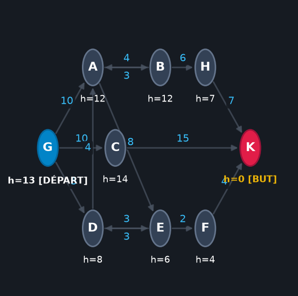
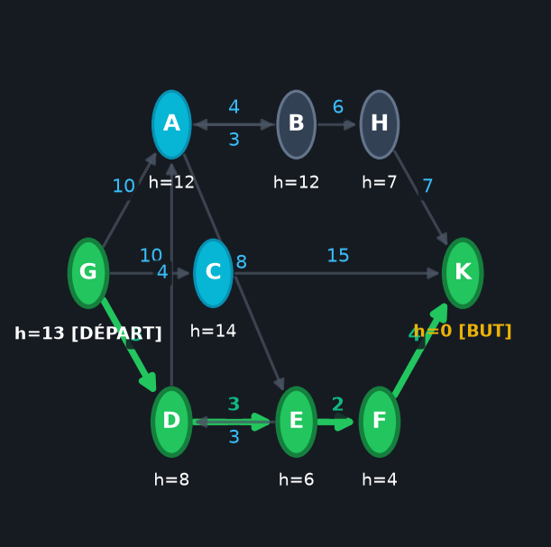
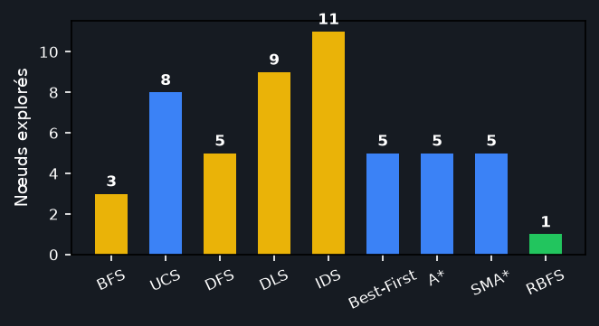
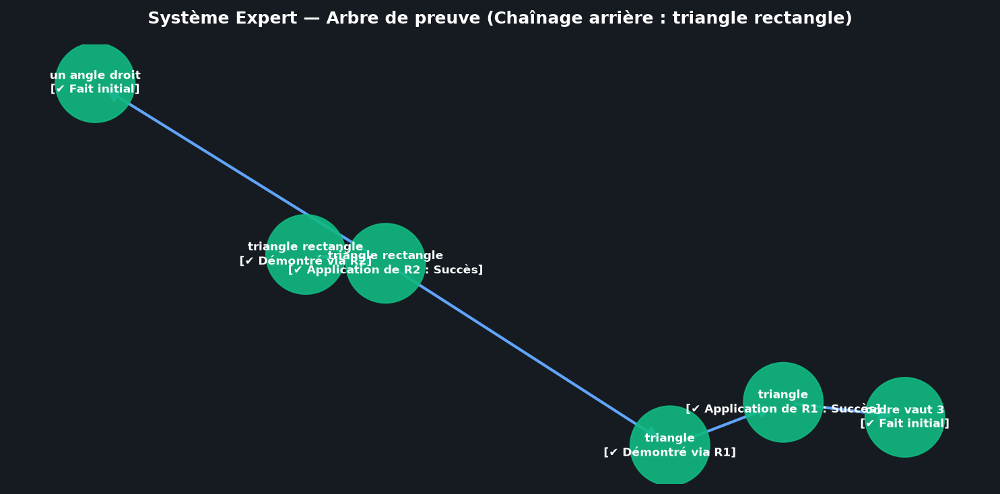

# Galerie et Documentation des Captures d'Écran

Ce dossier rassemble les illustrations visuelles des fonctionnalités majeures de l'application desktop développée pour l'ENSI.

---

## 1. Module 2 — Visualisation du Graphe du Cours (`graphe_visualisation.png`)
Représentation graphique interactive du graphe orienté et pondéré étudié en cours (sommets A à G) avec :
- Affichage des coordonnées 2D, des coûts sur chaque arc et des heuristiques \(h(n)\).
- Marquage distinctif du sommet initial (badge vert) et du sommet but (badge rouge).



---

## 2. Module 2 — Solution optimale A* en surbrillance (`recherche_astar_solution.png`)
Résultat de l'exécution de l'algorithme A* :
- Chemin optimal mis en valeur en vert épais (`A ➜ B ➜ D ➜ G`).
- Sommets explorés et frontière colorés dynamiquement.
- Panneau latéral affichant le coût total (\(c = 13\)), le nombre de nœuds développés et la trace pas-à-pas.



---

## 3. Module 2 — Comparatif des Algorithmes (`comparaison_algorithmes.png`)
Diagramme à barres comparant l'efficacité en nombre de nœuds développés de tous les algorithmes de recherche sur le graphe :
- Algorithmes non informés : BFS, UCS, DFS, DLS, IDS.
- Algorithmes informés : Recherche Gloutonne (Best-First), A*, SMA*, RBFS.
- Mise en évidence de l'algorithme optimal et le plus économe en développements.



---

## 4. Module 1 — Arbre de Preuve en Chaînage Arrière (`expert_arbre_preuve.png`)
Arbre de preuve déduit par le moteur d'inférence en chaînage arrière pour la base géométrique (`kb_triangle.json`) visant le but `triangle rectangle` :
- Décomposition récursive en sous-buts via la règle `R2`.
- Vérification des faits initiaux et des règles intermédiaires (`R1`).
- Validation visuelle avec symboles de statut `[✔]`.



---

## Régénération automatique
Pour régénérer l'ensemble de ces figures à tout moment :
```bash
python docs/screenshots/capture_screenshots.py
```
